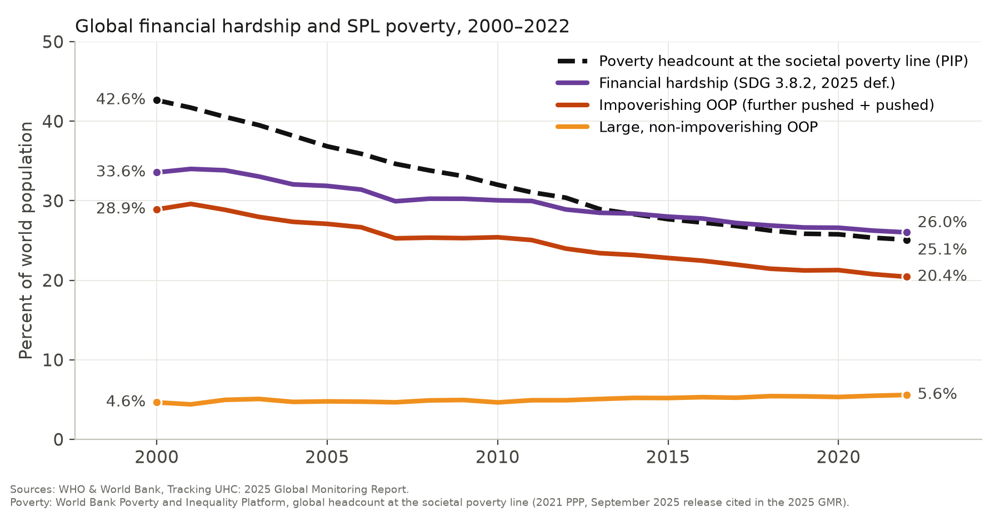
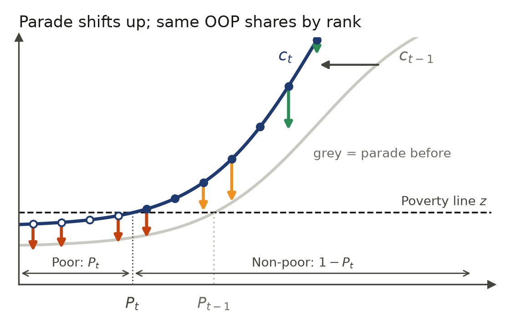
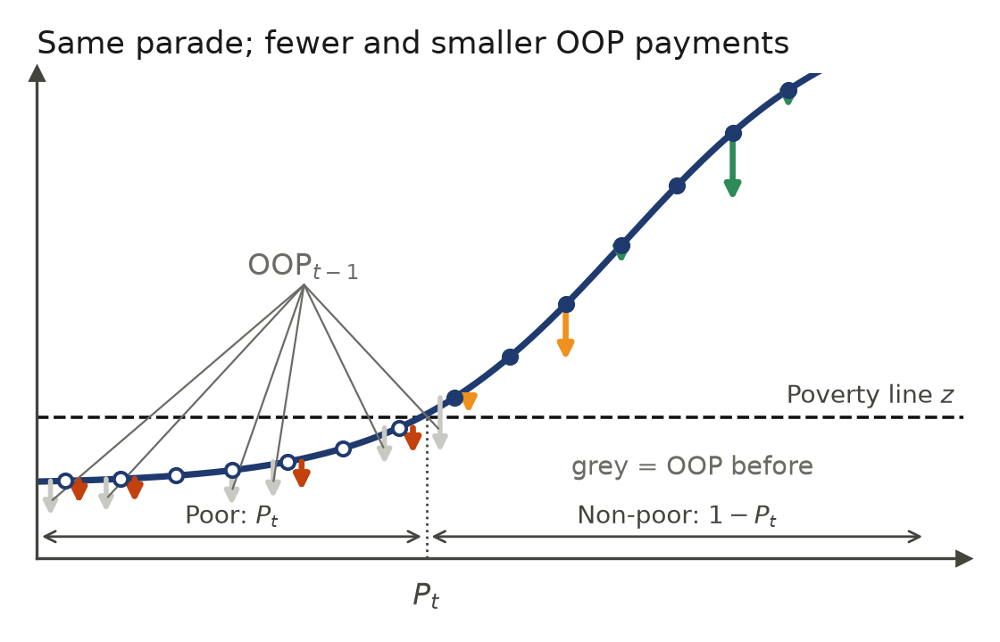
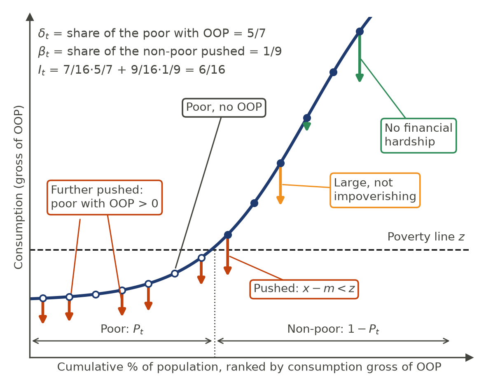
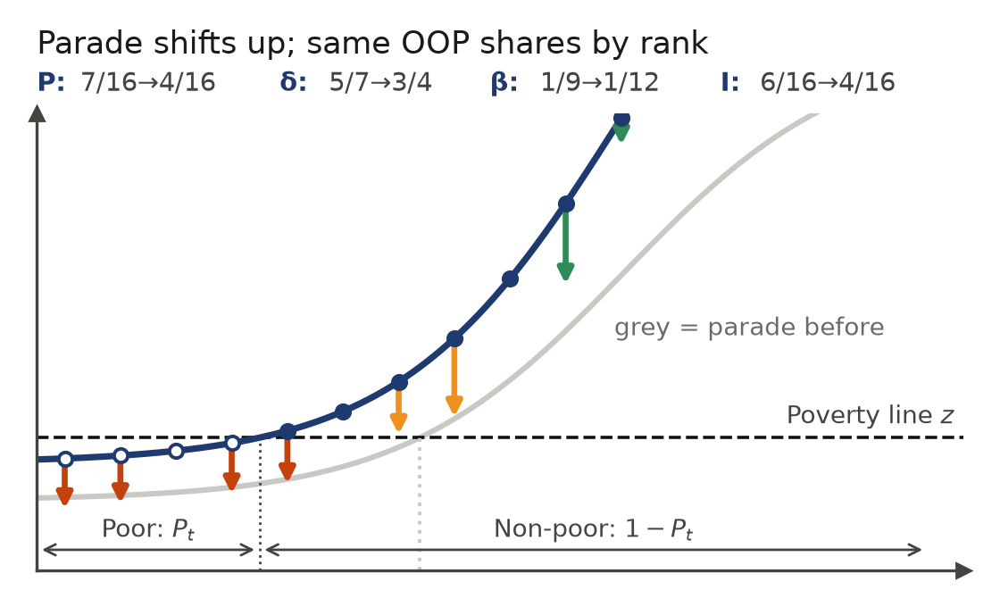
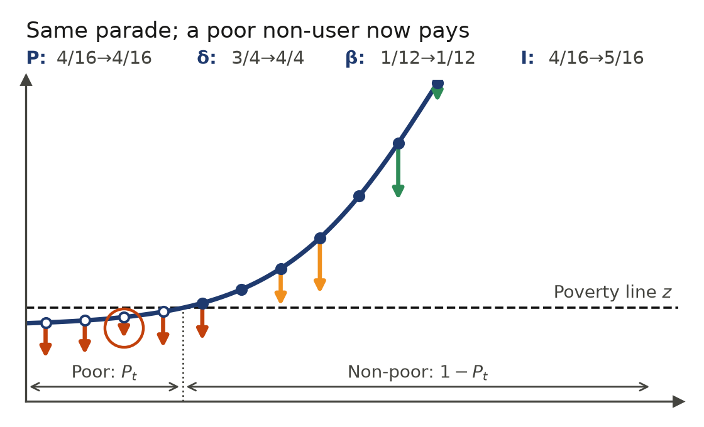
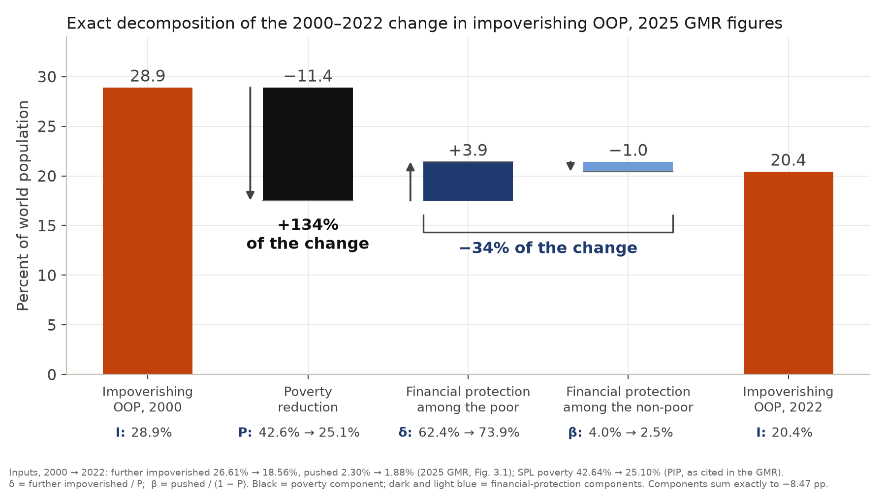

# Motivation

## Declining trends in global financial hardship and in global poverty reduction {.figure-slide}

::: {.content-visible when-format="revealjs"}
::: {.figure-row}
{width=100% fig-align="center"}
:::
:::
::: {.content-visible when-format="beamer"}
{width=70% fig-align="center"}
:::

::: {.content-visible when-format="revealjs"}
::: {.small}
Between 2000 and 2022, poverty at the societal poverty line fell from 42.6% to 25.1% of the world population and financial hardship (SDG 3.8.2, 2025 definition) from 33.6% to 26.0%, almost entirely through the *impoverishing* component (28.9% → 20.4%); large but non‑impoverishing OOP rose (4.6% → 5.6%) [@gmr2025].
:::
:::
::: {.content-visible when-format="beamer"}
From 2000 to 2022, poverty fell from 42.6% to 25.1% and financial hardship from 33.6% to 26.0%; lower impoverishing OOP drove most of the decline, while non-impoverishing OOP rose from 4.6% to 5.6% [@gmr2025].
:::

## Interpretation {.figure-slide}

::: {.columns align="top-baseline"}
::: {.column width="49%"}
```{=latex}
\footnotesize
```
**Story A — Poverty reduction is driving most of the changes in declining impoverishment**

::: {.med}
- Any poor household with OOP > 0 counts as impoverished: fewer poor, fewer impoverished.
- Financial protection may not have improved at all.
:::

:::
::: {.column width="49%"}
```{=latex}
\footnotesize
```
**Story B — Health systems are better at providing financial protection**

::: {.med}
- Prepaid, pooled financing expanded; user fees were removed.
- Fewer poor pay at the point of use; fewer are *pushed* below the line.
:::

:::
:::

::: {.content-visible when-format="revealjs"}
::: {.figure-row}
::: {.columns align="top-baseline"}
::: {.column width="49%"}
{width=100%}
:::
::: {.column width="49%"}
{width=100%}
:::
:::
:::
:::
::: {.content-visible when-format="beamer"}
::: {.columns align="top-baseline"}
::: {.column width="49%"}
{width=68%}
:::
::: {.column width="49%"}
{width=68%}
:::
:::
:::

. . .

```{=latex}
\footnotesize
```
::: {.content-visible when-format="revealjs"}
::: {.med}
In the 2025 GMR, we lean towards A: "the decline in impoverishing OOP health spending was driven by global poverty reduction rather than by health systems' ability to provide better financial protection to the poor" [@gmr2025]. **For the next GMR, we want to quantify this more precisely.**
:::
:::
::: {.content-visible when-format="beamer"}
The 2025 GMR attributes declining impoverishing OOP to global poverty reduction rather than improved health-system financial protection [@gmr2025]. **For the next GMR we want to quantify that finding more precisely.**
:::

## Objectives {.roomy .objectives}

```{=latex}
\setlength{\itemsep}{1.1em}
```
1. Partition the change in impoverishing OOP, $\Delta I$, into a **poverty component** and a **financial‑hardship component**, with no residual.
2. Implement the decomposition at two levels:
   - **(i) Macro-level**: from country‑year datapoints already published (poverty headcounts; impoverishment components).
   - **(ii) Micro-level**: from household survey data with total consumption, OOP and a poverty line.
3. Assess how the dynamics of poverty affected the dynamics of impoverishment.

# Measurement background

## SDG 3.8.2 indicator revision {.spaced shrink=8}

```{=latex}
\footnotesize
```
[**Poverty measurement**]{.sechead}

Per capita consumption $x_i$ (gross of OOP) and the societal poverty line [@jolliffeprydz2021]:

$$
z_t^{SPL}=\max\{2.15,\; 1.15+0.5\,\mathrm{med}_t(x-m)\}\ \ \text{(2017 PPP, per day)},\qquad P_t=\frac1N\sum_i\mathbf 1[x_i<z_t]
$$

[**Financial hardship measurement**]{.sechead}

OOP $m_i$ exceeding 40% of the discretionary budget $x_i-z_t$, in two mutually exclusive components [@gmr2025]:

$$
FH_t=\frac{1}{N}\sum_i \mathbf{1}\big[m_i>0.4\,(x_i-z_t),\; m_i>0\big]=I_t+L_t
$$

```{=latex}
\scriptsize
```
| Global estimates | Condition | 2000 | 2022 |
|-------------------------------------|----------------------------------------|-----:|-----:|
| SPL poverty headcount, $P_t$ | $x_i<z_t$ | 42.6% | 25.1% |
| Financial hardship, $FH_t=I_t+L_t$ | | 33.6% | 26.0% |
| Impoverishing OOP, $I_t$ | $x_i-m_i<z_t,\ m_i>0$ (further pushed + pushed) | 28.9% | 20.4% |
| Large, non‑impoverishing OOP, $L_t$ | $0.4(x_i-z_t)<m_i<x_i-z_t$ | 4.6% | 5.6% |

::: {.content-visible when-format="revealjs"}
::: {.small}
Sources: WHO & World Bank, 2025 Global Monitoring Report; poverty from the World Bank Poverty and Inequality Platform.
:::
:::

## Poverty and health impoverishment {.shrink}

- **"In poverty"**: Foster–Greer–Thorbecke [@fgt1984]:
$$
P_\alpha(y;z)=\frac1N\sum_i\left(\frac{z-y_i}{z}\right)^{\alpha}\mathbf 1[y_i<z]
$$

With $\alpha=0$ we have the poverty headcount: $P_0(x;z_t)=\frac1N\sum_i\mathbf 1[x_i<z_t]=P_t$.

- **"Pushed into poverty"** is the headcount difference $\Delta P_0=\underbrace{P_0(x-m;z)}_{\text{net of OOP}}-\underbrace{P_0(x;z)}_{\text{gross of OOP}}$ [@wagstaffvandoorslaer2003].
- **"Further pushed"** are the poor with $m_i>0$ [@gmr2025]: invisible to $\Delta P_0$, visible in the gap difference $\Delta P_1$.
- The **impoverishing component** of FH can therefore be rewritten as the poverty headcount on consumption net of OOP, restricted to people with positive OOP — it counts both the further pushed and the pushed:
$$
I_t=\frac1N\sum_i \mathbf 1[x_i-m_i<z_t]\,\mathbf 1[m_i>0]
=\underbrace{\Pr(x<z_t,\ m>0)}_{\text{further pushed}}+\underbrace{\Pr(x\ge z_t,\ x-m<z_t)}_{\text{pushed}}.
$$


# Intuition

## Poverty and health impoverishment

::: {.columns}
::: {.column width="44%"}
```{=latex}
\footnotesize
```
- Total impoverishment $I_t$ can also be rewritten as a **weighted average of two conditional hardship rates ($\delta_t$ and $\beta_t$)**, with weights given by the poverty headcount:

::: {.identity-box}
$$
\boxed{\boldsymbol{I_t = {\color{maroon}P_t}\,\delta_t + (1-{\color{maroon}P_t})\,\beta_t}}
$$
:::

- Let $P_t$ be the poverty headcount (gross consumption) measure, **$\delta_t=\Pr(m>0\mid x<z_t)$** the share of the poor with positive OOP and **$\beta_t=\Pr(x-m<z_t\mid x\ge z_t)$** the share of the non‑poor pushed below the line.
- **$\delta_t$** and **$\beta_t$** describe how impoverishment is measured for the *further pushed* and the *pushed*, respectively.
:::
::: {.column width="56%"}
{width=100%}
:::
:::

## Combined effects in impoverishment dynamics {.figure-slide .larger-text .combined-effects}

::: {.columns align="top-baseline"}
::: {.column width="49%"}
```{=latex}
\scriptsize
```
**Mechanical poverty effect**

::: {.med}
- If $\delta$ and $\beta$ are frozen, a fall in $P$ lowers $I$ by $(\delta-\beta)\,\Delta P$. With $\delta\approx0.7$ and $\beta\approx0.03$, each percentage point of poverty reduction removes about 0.65 points of impoverishment — without any change in health financing.
:::

:::
::: {.column width="49%"}
```{=latex}
\scriptsize
```
**Increased access effect**

::: {.med}
- Increased service utilization can translate into increased health OOP at the point of use, $\delta$ rises and $I$ rises.
- A health system that reaches more poor people with partially subsidized care can mean *worsening* $I_t$ (even though welfare could be higher with less foregone care).
:::

:::
:::

::: {.content-visible when-format="revealjs"}
::: {.figure-row}
::: {.columns align="top-baseline"}
::: {.column width="49%"}
{width=100%}
:::
::: {.column width="49%"}
{width=100%}
:::
:::
:::
:::
::: {.content-visible when-format="beamer"}
::: {.columns align="top-baseline"}
::: {.column width="49%"}
{width=68%}
:::
::: {.column width="49%"}
{width=68%}
:::
:::
:::

::: {.centered}
```{=latex}
\centering\footnotesize
```
Total impoverishment: [$\boxed{\boldsymbol{I_t = {\color{maroon}P_t}\,\delta_t + (1-{\color{maroon}P_t})\,\beta_t}}$]{.identity-box}
:::

. . .

```{=latex}
\footnotesize
```
::: {.med}
- A clean separation of $\Delta P$ from $(\Delta\delta,\Delta\beta)$ is therefore needed to **interpret trends**.
:::

# Complete decomposition

## Factor decomposition – Macro form {.shrink}

```{=latex}
\small
```
**Two‑factor Shapley decomposition**

- If we focus now on the decomposition of changes in impoverishment, we could express it as:

::: {.content-visible when-format="revealjs"}
::: {.eqgrid}
| $\Delta I$ | $=$ | $(\bar\delta-\bar\beta)\,\Delta P$ | $+$ | $\bar P\,\Delta\delta$ | $+$ | $(1-\bar P)\,\Delta\beta$ |
|:------:|:--:|:----------------:|:--:|:----------------:|:--:|:----------------:|
| change in impoverishment | | **poverty component**<br>$\Delta P$: change in poverty rate | | **FP among the poor**<br>$\Delta\delta$: change in FP among the poor (further pushed) | | **FP among the non‑poor**<br>$\Delta\beta$: change in FP among the non‑poor (pushed) |
:::
:::

::: {.content-visible when-format="beamer"}
$$
\underbrace{\Delta I}_{\begin{array}{c}\text{change in}\\ \text{impoverishment}\end{array}}
=\overbrace{(\bar\delta-\bar\beta)\,\underbrace{\Delta P}_{\begin{array}{c}\text{change in}\\ \text{poverty rate}\end{array}}}^{\text{poverty component}}
\;+\;\overbrace{\bar P\,\underbrace{\Delta\delta}_{\begin{array}{c}\text{change in FP among the}\\ \text{poor (further pushed)}\end{array}}}^{\text{FP among the poor}}
\;+\;\overbrace{(1-\bar P)\,\underbrace{\Delta\beta}_{\begin{array}{c}\text{change in FP among the}\\ \text{non-poor (pushed)}\end{array}}}^{\text{FP among the non-poor}}
$$
:::

- A bar denotes the mid‑point of the two periods: $\bar P=\tfrac12(P_0+P_1)$, $\;\bar\delta=\tfrac12(\delta_0+\delta_1)$, $\;\bar\beta=\tfrac12(\beta_0+\beta_1)$.

**Properties**

- **Full decomposition**: the three terms sum to $\Delta I$ with zero residual.
- **Symmetric.** Two‑factor Shapley value [@shorrocks2013]. Coincides with the average of the two sequential (Oaxaca‑type) decompositions; it is the analogue of @dattravallion1992 and @kakwani2000 for impoverishment.
- **Additive across countries**: with population weights $\omega_{ct}$, $\Delta I_W=\sum_c\Delta\omega_c\bar I_c+\sum_c\bar\omega_c\Delta I_c$, and each $\Delta I_c$ splits as above.

## Key parameters from the 2025 GMR (global, 2000 → 2022) {.bigtable shrink=8}

```{=latex}
\small
```
| Parameter | 2000 | 2022 | Change (pp) | Mid‑point | Source |
|----------------------------------------|-------:|-------:|--------:|---------:|----------------|
| Poverty headcount at the SPL, $P$ | 42.6% | 25.1% | −17.5 | 33.9% | GMR (PIP) |
| **Impoverishing OOP, $I=B+A$** | **28.9%** | **20.4%** | **−8.5** | | GMR |
| Further pushed, $B=P\,\delta$ | 26.6% | 18.6% | −8.1 | | GMR, Fig. 3.1 |
| Pushed, $A=(1-P)\,\beta$ | 2.3% | 1.9% | −0.4 | | GMR, Fig. 3.1 |
| Share of the poor who pay OOP, $\delta=B/P$ | 62.4% | 73.9% | +11.5 | 68.2% | derived |
| Share of the non‑poor pushed, $\beta=A/(1-P)$ | 4.0% | 2.5% | −1.5 | 3.3% | derived |

::: {.small}
$P$: World Bank PIP, global SPL headcount, 2021 PPP, [@gmr2025].
:::

## Illustration with the 2025 GMR global figures (2000 → 2022) {.figure-slide shrink=10}

::: {.content-visible when-format="revealjs"}
::: {.figure-row}
{width=100% fig-align="center"}
:::
:::
::: {.content-visible when-format="beamer"}
{width=68% fig-align="center"}
:::

::: {.small}
**P:** 42.6% → 25.1%; **$\boldsymbol{\delta}$:** 62.4% → 73.9%; **$\boldsymbol{\beta}$:** 4.0% → 2.5%; **I:** 28.9% → 20.4%. Poverty component $(\bar\delta-\bar\beta)\,\Delta P=(0.682-0.033)\times(-17.5)=-11.4$ pp; FP among the poor $\bar P\,\Delta\delta=0.339\times11.5=+3.9$ pp; FP among the non‑poor $(1-\bar P)\,\Delta\beta=0.661\times(-1.5)=-1.0$ pp; total $-8.5$ pp.
:::

## Summary

- **Poverty reduction more than explains the decline**: on its own it would have lowered impoverishing OOP by 11.4 pp, against 8.5 pp observed (134% of the change).
- The financial‑protection component **contributes against the decrease in total impoverishment** (so financial hardship increases and dampens the effect of poverty reduction): among the poor, the probability of paying something out of pocket rose, from 62% to 74% (+3.9 pp). This is consistent with expanded utilisation with incomplete coverage, and with the rise of the *large OOP* component in middle‑income countries.
- Among the non‑poor, fewer were pushed below the line: 4.0% → 2.5% (−1.0 pp). Part of this fall can be mechanical, since fewer people live just above the line when poverty falls.


# Implementation (i): global estimates from country‑level datapoints

## Aggregate data (global estimates) {.compact .shrink}

```{=latex}
\scriptsize
```

| Object | Source | Notes |
|------------------|--------------------------------------------|----------------------------------|
| $P_{ct}$ poverty headcount at $z$ | WHO–WB UHC GMR: reconstructed poverty headcount for country $c$ in year $t$ | Reconstructed to align the welfare aggregate (gross of OOP) with the one used for financial hardship |
| $B_{ct}$ further pushed | WHO–WB UHC GMR | Country‑year, survey years and modelled |
| $A_{ct}$ pushed into poverty | WHO–WB UHC GMR | Country‑year, survey years and modelled |
| $\omega_{ct}$ population | UN World Population Prospects | For world and regional aggregates |

- **Calibration of parameters (conditional rates)**: $\delta_{ct}=B_{ct}/P_{ct}$ and $\beta_{ct}=A_{ct}/(1-P_{ct})$.
  - $\delta_{ct}$: among the poor of country $c$ in year $t$, the share who paid anything out of pocket (the further pushed, divided by the poor).
  - $\beta_{ct}$: among the non‑poor, the share whose OOP took them below the line (the pushed, divided by the non‑poor).
  - All three come from the same surveys, so $B_{ct}\le P_{ct}$ and the identity holds exactly for each country‑year.
- **Steps**
  1. Build a country panel at survey years.
  2. Compute the three components for each country between first and last survey (or between fixed years using the modelled series, flagged).
  3. Aggregate using population weights $\omega_{ct}$.
  4. Report at global and by region and income group.

# Implementation (ii): household survey microdata

## (a) Two repeated cross‑sections: simple approach, direct distributions {.steps}

```{=latex}
\footnotesize
```
Two surveys of the same country, at $t_0$ and $t_1$ (different households). For each household: consumption $x_i$ (gross of OOP), OOP $m_i$, the poverty line $z_t$ and a sampling weight.

1. **Flag every household** in each survey: *poor* if $x_i<z_t$; *further pushed* if poor and $m_i>0$; *pushed* if non‑poor and $x_i-m_i<z_t$.
2. **Compute three weighted shares** in each survey: $P_t$, the share who are poor; $\delta_t$, the share of the poor who pay something out of pocket; $\beta_t$, the share of the non‑poor pushed below the line. Check that $P_t\delta_t+(1-P_t)\beta_t$ gives back the impoverishment rate $I_t$.
3. **Plug these six numbers into the same formula** as for the global figures:

::: {.content-visible when-format="revealjs"}
::: {.eqgrid}
| $\Delta I$ | $=$ | $(\bar\delta-\bar\beta)\,\Delta P$ | $+$ | $\bar P\,\Delta\delta$ | $+$ | $(1-\bar P)\,\Delta\beta$ |
|:------:|:--:|:----------------:|:--:|:----------------:|:--:|:----------------:|
| change in impoverishment | | **poverty component** | | **FP among the poor** | | **FP among the non‑poor** |
:::
:::
::: {.content-visible when-format="beamer"}
$$
\Delta I=\underbrace{(\bar\delta-\bar\beta)\,\Delta P}_{\text{poverty component}}
\;+\;\underbrace{\bar P\,\Delta\delta}_{\text{FP among the poor}}
\;+\;\underbrace{(1-\bar P)\,\Delta\beta}_{\text{FP among the non-poor}}
$$
:::

**Standard errors**: bootstrap over PSUs within strata, repeating steps 1–3 in each replicate.

## (b) Two repeated cross‑sections: simulated approach (change one dimension at a time) {.steps}

```{=latex}
\footnotesize
```
Impoverishment combines two distributions: Consumption (**who is poor**) and **who pays, and how much** (OOP as a share of consumption, $m_i/x_i$, at each consumption percentile). With microdata we can simulate them:

| | OOP pattern of $t_0$ | OOP pattern of $t_1$ |
|:--------------------|:------------------:|:------------------:|
| **Consumption of $t_0$** | $I_{00}$ observed | $I_{01}$ simulated |
| **Consumption of $t_1$** | $I_{10}$ simulated | $I_{11}$ observed |

- **Building the simulated distributions**: rank households by consumption in each survey; give each $t_1$ household the OOP shares of $t_0$ households in the same percentile, and count who is impoverished ($I_{10}$); $I_{01}$ is the other distribution.
- **Poverty component**: what happens when only consumption changes, $\tfrac12[(I_{10}-I_{00})+(I_{11}-I_{01})]$.
- **Financial‑protection component**: what happens when only the OOP pattern changes, $\tfrac12[(I_{01}-I_{00})+(I_{11}-I_{10})]$.
- Both should add up exactly to $\Delta I=I_{11}-I_{00}$. Unlike the previous application, the poverty component also captures changes in *who* is poor and *how many* live just above the line.

## (c) Two panel waves: follow the same households {.steps .panel}

```{=latex}
\footnotesize
```
The same households are interviewed at $t_0$ and $t_1$. Both cross‑section methods still apply to each wave; the panel adds **who moved in and out of impoverishment, and through which channel**. Give each household one of four statuses in each wave and cross‑tabulate them (panel weights, % of population):

```{=latex}
\scriptsize
```
| Status at $t_0$ $\downarrow$ / at $t_1$ $\rightarrow$ | i | ii | iii | iv |
|:--------------------------------------|:----------:|:----------:|:----------:|:----------:|
| **i** poor, pays OOP (*further pushed*) | · | exit, FP | · | exit, poverty |
| **ii** poor, no OOP | entry, FP | · | entry, poverty | · |
| **iii** non‑poor, pushed below the line (*pushed*) | · | exit, poverty | · | exit, FP |
| **iv** non‑poor, not pushed | entry, poverty | · | entry, FP | · |

```{=latex}
\footnotesize
```
- i and iii are impoverished; · means no change in impoverishment status.
- **Poverty channel**: the household left or fell into poverty. 
- **FP channel**: same poverty status, but it started or stopped paying OOP.
- $\Delta I$ = entries − exits = poverty channel + FP channel.
- **Panel data**: does paying OOP at $t_0$ make it harder to leave poverty, or easier to fall into it, by $t_1$? Compare payers and non‑payers with similar consumption at $t_0$.

## References {.refs shrink=8}

```{=latex}
\setbeamerfont{bibliography item}{size=\scriptsize}
\setbeamerfont{bibliography entry author}{size=\scriptsize}
\setbeamerfont{bibliography entry title}{size=\scriptsize}
\setbeamerfont{bibliography entry location}{size=\scriptsize}
\setbeamerfont{bibliography entry note}{size=\scriptsize}
\scriptsize
\renewenvironment{CSLReferences}[2]{\begin{list}{}{\setlength{\topsep}{0pt}\setlength{\partopsep}{0pt}\setlength{\leftmargin}{1.2em}\setlength{\itemindent}{-1.2em}\setlength{\parsep}{0pt}\setlength{\itemsep}{0.45\baselineskip}}}{\end{list}}
\begin{multicols}{2}
```
::: {#refs}
:::
```{=latex}
\end{multicols}
```

## Questions/Comments {.closing .figure-slide}

::: {.content-visible when-format="revealjs"}
::: {.figure-row}
{width=100% fig-align="center"}
:::
:::
::: {.content-visible when-format="beamer"}
{width=70% fig-align="center"}
:::

```{=latex}
\vfill
\centering\Large
```
::: {.closing-contact}
Patrick Eozenou ([peozenou@worldbankgroup.org](mailto:peozenou@worldbankgroup.org))
:::
```{=latex}
\vfill
```